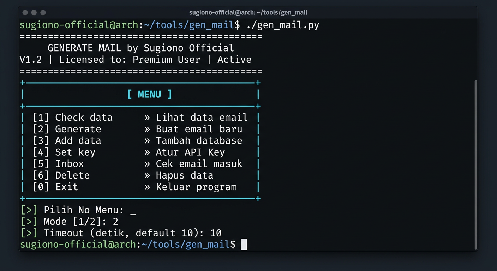

# Tempmail-MCP

**By Sugiono Official**

<p align="center">
  
</p>

A self-hosted temporary email REST API with a built-in web UI and optional MCP server.
Multiple disposable-inbox providers are aggregated behind a single API; broken providers are automatically detected and disabled at startup.

Includes a cross-platform CLI helper — **GENERATE MAIL by Sugiono Official** (`mail_helper.py`) — for interactive generation, checking, and deleting of aliases with two modes (Tag+ Gmail and SimpleLogin).

---

## Features

- **Multi-provider** — SimpleLogin, mail.tm, tempmail.io, Gmail (IMAP), mailticking, tempmailo, tempail
- **Two alias modes** — **Tag+ (Gmail)** generates `user+<tag>@gmail.com`; **SimpleLogin** creates random unique aliases (`@simplelogin.co` / `@simplelogin.com` / `@sl.lan`) forwarding to your real inbox
- **Auto-fallback** — picks the first healthy provider in priority order
- **Circuit breaker** — providers that fail 3× in a row are auto-disabled; re-enable via API
- **Startup health-check** — broken providers are disabled before the first request
- **Resilient CLI** — delete/network/timeout errors show a status and keep the menu alive (no crashes); SimpleLogin 429 rate-limit is retried with backoff
- **Web UI** — tab-based email client, multi-account, localStorage persistence, auto-refresh, browser notifications
- **Shared/pinned emails** — pin mailboxes server-side so every client can use them
- **Swagger docs** — `/docs`
- **MCP server** — optional, usable standalone by Claude / any MCP client
- **Cloudflare bypass** — via [FlareSolverr](https://github.com/FlareSolverr/FlareSolverr) for providers that require it

---

## CLI Helper — GENERATE MAIL by Sugiono Official

A stdlib-only, cross-platform terminal helper (`mail_helper.py`) for everyday use.
Run it directly to open an interactive menu loop:

```bash
python mail_helper.py
```

Menu:

| Option | Action |
|---|---|
| `1` | **Check data** — show stored account data, then return to menu |
| `2` | **Generate** — pick a mode (Tag+ / SimpleLogin), create an alias, wait for mail |
| `3` | **Add data** — add a Gmail account (email + app password) to `config.json` |
| `4` | **Set key** — enter the SimpleLogin API key |
| `5` | **Inbox** — diagnose the real inbox (last 10 messages, open body) |
| `6` | **Delete** — list aliases and delete one (`1-N`), all (`all`), or back (`0`) |
| `0` | **Exit** |

### Two generation modes

| Mode | Alias shape | Requires |
|---|---|---|
| `tag` (Tag+ / Gmail) | `user+<tag>@gmail.com` | Gmail account (`GMAIL_EMAIL` + `GMAIL_APP_PASSWORD`) |
| `simplelogin` | random unique alias (`@simplelogin.co` / `@simplelogin.com` / `@sl.lan`) | `SIMPLELOGIN_API_KEY` + `GMAIL_EMAIL` + `GMAIL_APP_PASSWORD` |

`--mode` is optional on every command — if omitted, the helper asks interactively (for `gen`/`run`) or auto-detects from the email (for `check`/`watch`/`del`).

### Commands

```bash
python mail_helper.py                 # interactive menu loop
python mail_helper.py gen --mode tag               # create one alias (Tag+)
python mail_helper.py gen --mode simplelogin       # create one alias (SimpleLogin)
python mail_helper.py run --mode simplelogin --timeout 10 --interval 3   # create + wait for mail
python mail_helper.py add                            # add a Gmail account
python mail_helper.py key                            # set SimpleLogin API key
python mail_helper.py inbox                          # diagnose real inbox
python mail_helper.py del <email> [token]           # delete one alias (token auto-found if omitted)
python mail_helper.py check <email> <token>         # list incoming messages
python mail_helper.py watch <email> <token> [--timeout N --interval N]   # poll until mail arrives
```

Verification codes are extracted and shown prominently as a `KODE :` line. A delete that times out but actually succeeds is reported as success (verified against the live alias list), and SimpleLogin `429` rate-limits are retried with exponential backoff before failing gracefully.

---

## Quick start (Docker Compose)

```bash
cp .env.example .env
# edit .env if needed (Gmail credentials, ports, …)
docker compose up -d
```

- Web UI → http://localhost:8000
- Swagger → http://localhost:8000/docs

---

## Configuration (`.env`)

| Variable | Default | Description |
|---|---|---|
| `HOST` | `0.0.0.0` | Bind address |
| `PORT` | `8000` | HTTP port |
| `RELOAD` | `false` | Uvicorn hot-reload (dev only) |
| `ENABLE_FRONTEND` | `true` | Serve the web UI |
| `FLARESOLVERR_URL` | `http://localhost:8191` | FlareSolverr endpoint |
| `HEALTH_CHECK_ON_STARTUP` | `true` | Probe all providers at startup and disable failures |
| `SHARED_EMAILS_PATH` | `shared_emails.json` | Path to the server-side pinned-emails store |
| `GMAIL_EMAIL` | — | Gmail address (single account, alias mode) |
| `GMAIL_APP_PASSWORD` | — | Gmail app password (single account, alias mode) |
| `GMAIL_ACCOUNTS` | — | JSON array of `{email, app_password}` for Gmail **pool** mode (real accounts, round-robin) |
| `GMAIL_EMAILS` | — | Comma-separated Gmail addresses (pool mode, alternative to `GMAIL_ACCOUNTS`) |
| `GMAIL_APP_PASSWORDS` | — | Comma-separated app passwords aligned to `GMAIL_EMAILS` (pool mode) |
| `SIMPLELOGIN_API_KEY` | — | SimpleLogin API key (`https://app.simplelogin.io/settings/api`) — random aliases forwarding to your real inbox |

---

## REST API

### System

| Method | Path | Description |
|---|---|---|
| `GET` | `/api/health` | Health status of all providers (200 if all ok, 207 if degraded) |

**Response `GET /api/health`**
```json
{
  "healthy": true,
  "providers": {
    "mail.tm":    { "status": "ok" },
    "mailticking": { "status": "disabled", "failures": 3 }
  }
}
```

---

### Providers

| Method | Path | Description |
|---|---|---|
| `GET` | `/api/providers` | List all providers with enabled/failure state |
| `POST` | `/api/providers/{name}/disable` | Manually disable a provider |
| `POST` | `/api/providers/{name}/enable` | Re-enable a provider and reset failure counter |
| `GET` | `/api/domains?name=<provider>` | List available domains for a provider |

**Response `GET /api/providers`**
```json
[
  { "name": "gmail",      "disabled": false, "failures": 0 },
  { "name": "mail.tm",    "disabled": false, "failures": 0 },
  { "name": "mailticking","disabled": true,  "failures": 3 }
]
```

---

### Email

`name` is optional on every endpoint — omitted means "auto" (first healthy provider in priority order).

| Method | Path | Description |
|---|---|---|
| `POST` | `/api/email?name=<provider>` | Create a new temporary mailbox |
| `GET` | `/api/email/{email}/messages?token=X&name=Y` | List messages for a mailbox |
| `GET` | `/api/email/{email}/message/{id}?token=X&name=Y` | Get a full message (with body) |
| `DELETE` | `/api/email/{email}?token=X&name=Y` | Delete the mailbox |

**Request `POST /api/email`**
```json
{
  "min_name_length": 10,
  "max_name_length": 10,
  "domain": null
}
```

**Response `POST /api/email`**
```json
{
  "email": "randomname@mail.tm",
  "token": "eyJ...",
  "provider": "mail.tm"
}
```

**Response `GET /api/email/{email}/messages`**
```json
[
  {
    "id": "abc123",
    "from_addr": "\"Alice\" <alice@example.com>",
    "to_addr": "randomname@mail.tm",
    "subject": "Your verification code",
    "body_text": null,
    "body_html": null,
    "created_at": "1742900000",
    "attachments": []
  }
]
```

**Response `GET /api/email/{email}/message/{id}`**
```json
{
  "id": "abc123",
  "from_addr": "\"Alice\" <alice@example.com>",
  "to_addr": "randomname@mail.tm",
  "subject": "Your verification code",
  "body_text": "Your code is 123456",
  "body_html": "<html>...</html>",
  "created_at": "1742900000",
  "attachments": [
    { "filename": "invoice.pdf", "content_type": "application/pdf", "size": 42300, "url": null }
  ]
}
```

---

### Shared / Pinned emails

Pin a mailbox server-side so every client can see and reuse it.

| Method | Path | Description |
|---|---|---|
| `GET` | `/api/shared` | List all pinned email accounts |
| `POST` | `/api/shared` | Pin an email (visible to all clients) |
| `PATCH` | `/api/shared/{email}` | Rename a pinned email (update label) |
| `DELETE` | `/api/shared/{email}` | Unpin an email |

**Request `POST /api/shared`**
```json
{
  "email": "randomname@mail.tm",
  "token": "eyJ...",
  "provider": "mail.tm",
  "label": "My shared inbox"
}
```

**Response `GET /api/shared`**
```json
[
  {
    "email": "randomname@mail.tm",
    "token": "eyJ...",
    "provider": "mail.tm",
    "label": "My shared inbox",
    "pinned_at": 1742900000
  }
]
```

---

## Providers

Priority order (first healthy provider wins):

| Priority | Name | Type | Requires FlareSolverr | Notes |
|---|---|---|---|---|
| 1 | `gmail` | IMAP | No | **Alias mode**: needs `GMAIL_EMAIL` + `GMAIL_APP_PASSWORD` — generates `user+<tag>@gmail.com` |
| 1 | `gmail` | IMAP | No | **Pool mode**: needs `GMAIL_ACCOUNTS` (or `GMAIL_EMAILS` + `GMAIL_APP_PASSWORDS`) — hands out real, independent Gmail accounts round-robin |
| 2 | `simplelogin` | REST API | No | Needs `SIMPLELOGIN_API_KEY` + `GMAIL_EMAIL` + `GMAIL_APP_PASSWORD` — creates **random unique aliases** (`@simplelogin.co` / `@simplelogin.com` / `@sl.lan`) that forward to your real inbox. `429` rate-limits are retried with exponential backoff |
| 3 | `mail.tm` | REST API | No | Most reliable fallback |
| 3 | `tempmail.io` | REST API | No | Reliable |
| 4 | `mailticking` | Scraping | Yes | CF-protected |
| 5 | `tempmailo` | Scraping | Yes | CF-protected |
| 6 | `tempail` | Scraping | Yes | May be blocked by reCAPTCHA |

At startup, each provider is probed with a real `create_email` call. Any provider that fails is auto-disabled before serving requests.

---

## MCP server

The MCP server is exposed automatically at **`/mcp/`** (streamable-http transport) when the FastAPI app runs — no separate process needed.

### HTTP transport (recommended)

Add to your MCP config (`~/.mcp.json` for Claude Code, `~/.config/claude/claude_desktop_config.json` for Claude Desktop):

```json
{
  "mcpServers": {
    "tempmail": {
      "type": "http",
      "url": "https://your-host/mcp/"
    }
  }
}
```

> **Note:** The trailing slash in `/mcp/` is required.

### Standalone stdio mode

```bash
python -m src.mcp_server
```

```json
{
  "mcpServers": {
    "tempmail": {
      "command": "python",
      "args": ["-m", "src.mcp_server"],
      "cwd": "/path/to/tempmail-api"
    }
  }
}
```

### Available tools

| Tool | Description |
|---|---|
| `list_providers` | List all providers with status (`disabled`, `failures`) |
| `disable_provider` | Manually disable a provider |
| `enable_provider` | Re-enable a provider and reset failure counter |
| `get_domains` | List available domains for a provider |
| `create_email` | Create a new disposable mailbox |
| `get_messages` | Poll the inbox for new messages |
| `read_message` | Read the full body of a message |
| `delete_email` | Destroy a mailbox |
| `list_pinned` | List all shared/pinned emails |
| `pin_email` | Pin a mailbox so all clients can reuse it |
| `unpin_email` | Remove a pinned email |
| `rename_email` | Update the display label of a pinned email |

---

## Development

```bash
pip install -r src/requirements.txt
RELOAD=true python -m src.main
```

FlareSolverr (required for CF-protected providers):

```bash
docker run -p 8191:8191 ghcr.io/flaresolverr/flaresolverr:latest
```
